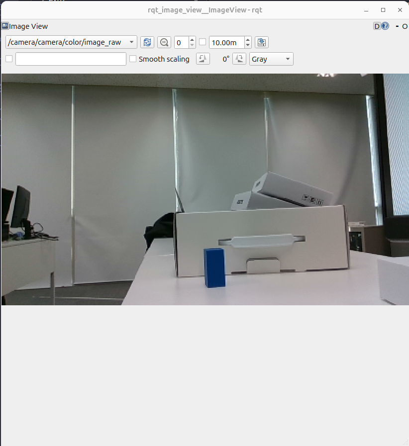
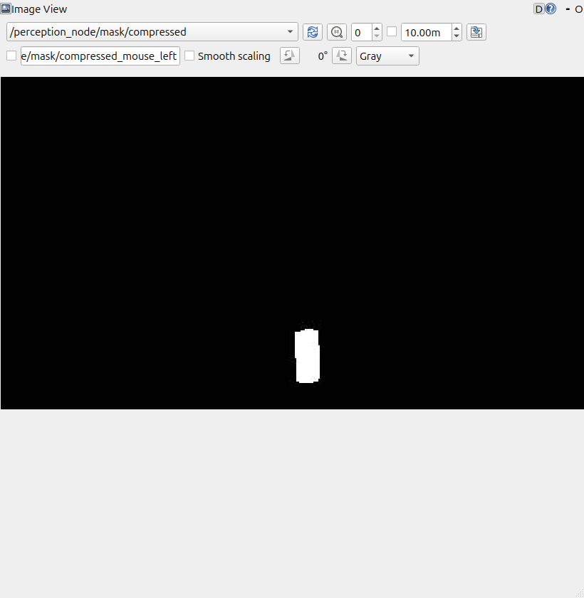
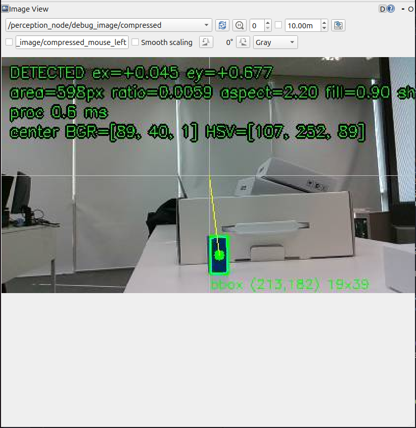
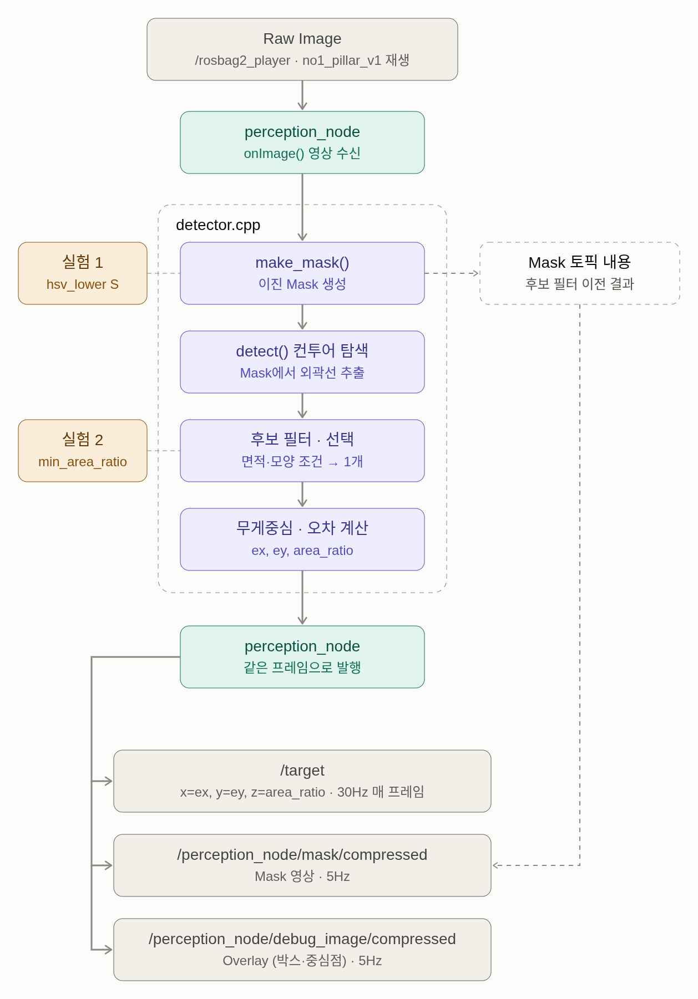
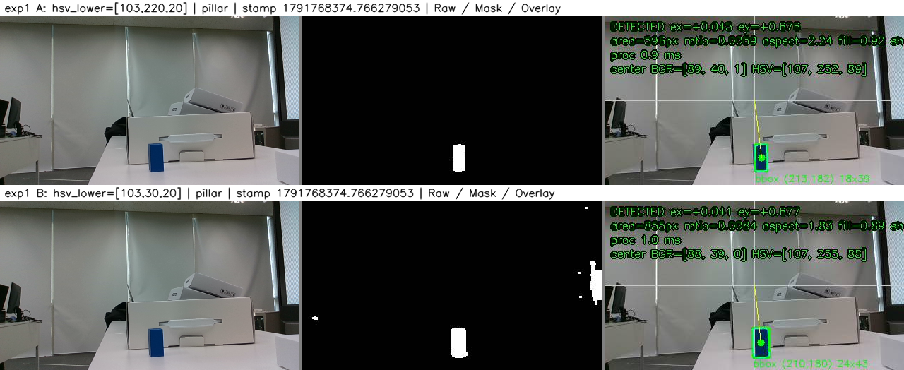
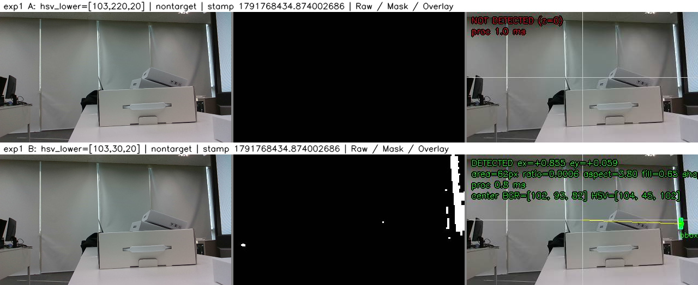
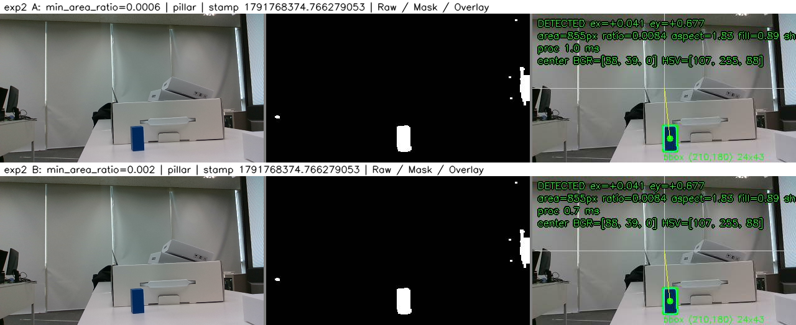
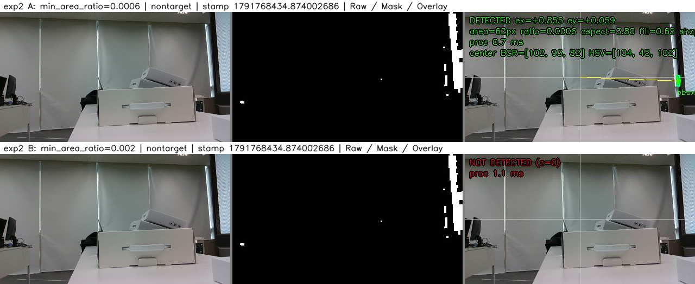
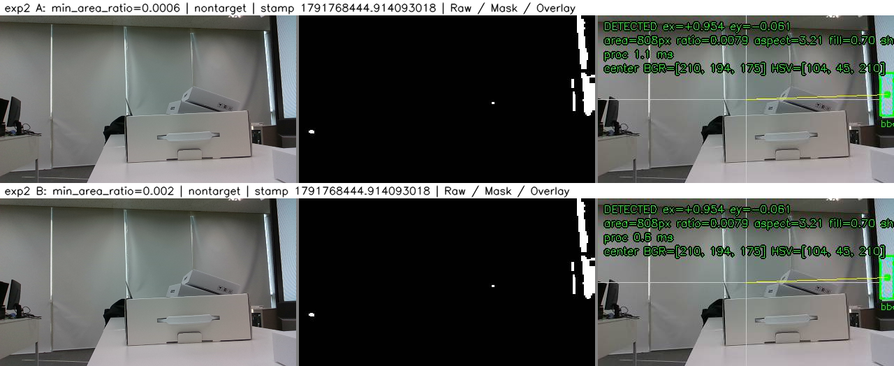

# Lv2. Module③ 과제

## 과제 설명
어떤 설정값을 사용하면 Mask와 검출 결과가 어떻게 달라지는지 실험으로 확인하고, 해당 값을 선택한 근거를 설명하는 과제예요. 기존 비전 노드의 설정값을 바꾸고 Raw Image·Mask·검출 결과를 ROS 2 토픽으로 받아, 예상한 변화와 실제 결과를 비교한 분석 보고서를 작성해요. 기존 수업 코드나 프로젝트의 비전 노드를 재사용하며, 모터 제어와 새 코드 구현은 제외해요.

- 수행 방식: 개인 과제
- 예상 소요 시간: 하루 이내, 기존 실행 환경 기준 약 4~6시간
- 제출 일정: 2026-10-12~2026-10-14
- 학습 범위: 모듈 3의 HSV 검출과 ROS 2 이미지 토픽 연동, 19·21강 중심

## 제출 시 유의사항
- 제출 범위는 **설정값 변경에 따른 Mask·검출 결과의 변화 검증과 분석 보고서**예요. 모터 제어, Calibration·PnP 분석, 신규 패키지·알고리즘 구현은 포함하지 않아요.
- 프로젝트 코드를 재사용해도 보고서는 개인별로 작성해요. 사용한 저장소·커밋·실행 파일을 기록해요.
- 토픽 목록에 이름이 있는 것만으로는 수신 확인이 되지 않아요. 이미지가 표시되거나 메시지가 실제로 수신된 증거를 남겨요. OpenCV 로컬 창만 띄운 화면도 토픽 수신 증거로 대신하지 않아요.
- 직접 구독한 결과를 제출해요. rosbag을 입력으로 사용했다면 재생 자료의 출처와 관찰 구간을 적고, 실시간 Camera 촬영과 구분해요.
- 실행 환경은 실제 사용한 Python·OpenCV·ROS 2 버전을 기록해요. 수업에서 정상 동작한 환경을 유지하며, 이 과제를 위해 OS나 ROS 2 버전을 변경할 필요는 없어요.
- 비밀번호·개인 키 등 인증 정보와 재배포 권한이 없는 교재 원문·타인의 코드는 저장소에 올리지 않아요. 분석 대상은 출처 링크와 필요한 최소 코드 인용으로 남길 수 있어요.

## 수강생 과제 수행 TIP
1. 먼저 `ros2 topic list -t`로 실제 토픽 이름과 메시지 타입을 확인해요. 문서의 예시 이름을 그대로 가정하지 않아요.
2. `ros2 topic info <토픽명> --verbose`로 발행·구독 노드와 QoS를 확인해요. 수신되지 않으면 노드 실행 상태와 발행자·구독자의 QoS 호환성을 점검해요.
3. Raw Image와 Mask는 `rqt_image_view` 등 수업에서 사용하는 토픽 뷰어에서 각각 선택해요. 이미지의 큰 `data` 배열 전체를 보고서에 붙이지 않아도 돼요.
4. 검출 결과는 `ros2 topic echo <검출_토픽명>` 또는 제공된 Subscriber로 확인해요. 메시지 필드는 `ros2 interface show <메시지_타입>`과 기존 코드에서 확인해요.
5. 비교 실험은 동일한 Raw Image를 사용해요. 같은 rosbag 구간이나 수업에서 제공한 고정 이미지 입력을 반복 사용하고, 프레임 시각 또는 번호를 기록해요. 실시간 Camera를 사용한다면 위치·조명·노출·해상도를 고정하고, 입력의 변화가 결과에 영향을 줄 수 있음을 적어요.
6. 오류가 나면 실행 명령, 토픽 이름·타입, 출력 메시지를 함께 정리해 질문해요.

## 과제 목표
Raw Image·Mask·검출 결과를 ROS 2 토픽으로 수신하고, 설정값 → 처리 조건 → 출력 변화의 관계를 근거로 설명해요. 주어진 입력에서 목표를 남기고 불필요한 검출을 줄이려면 어떤 값을 선택해야 하는지, 비교 실험으로 뒷받침해요.

## 문제1. 기존 비전 노드 실행과 토픽 구조 확인
1. 수업에서 제공한 실행 방법으로 Camera 입력 또는 rosbag 재생과 비전 처리 노드를 실행해요. 모터 제어 노드는 실행 대상에서 제외해요.
2. 토픽 목록에서 Raw Image·Mask·검출 결과에 해당하는 토픽을 찾아요.
3. 아래 형식으로 실제 토픽 이름, 메시지 타입, 발행 노드, 수신 도구를 기록해요.

| 자료 | 토픽 이름 | 메시지 타입 | 발행 노드 | 수신 도구 |
|---|---|---|---|---|
| Raw Image | 실제 이름 작성 | 실제 타입 작성 | 실제 노드 작성 | 이미지 토픽 뷰어 |
| Mask | 실제 이름 작성 | 실제 타입 작성 | 실제 노드 작성 | 이미지 토픽 뷰어 |
| 검출 결과 | 실제 이름 작성 | 실제 타입 작성 | 실제 노드 작성 | CLI 또는 제공된 Subscriber |
- /image_raw, /mask, /detection은 설명용 예시예요. 실제 노드의 이름을 사용해요. 검출 결과가 수치 메시지와 Overlay 이미지로 나뉘어 있으면 두 토픽을 함께 적어요.
---------------

### 1. 답안 내용

- **사용한 비전 노드 (재사용 코드)**

| 항목 | 내용 |
|---|---|
| 실행 파일 | `realsense.launch.py` (카메라 + `perception_node`), 노드 `perception_node` (C++) |
| 설정 파일 | `config/realsense.yaml` (HSV 범위, 면적·모양 필터 등 ROS 2 파라미터) |
| 제외한 노드 | 모터 제어 노드(`dynamixel_move_node`, `dynamixel_controller`)는 실행하지 않음 → 아래 `ros2 node list`에 없음 |

- **실행 환경** ([results/problem1/00_env.txt](results/problem1/00_env.txt))

| 항목 | 버전 |
|---|---|
| OS | Ubuntu 24.04.5 LTS (개발 PC) |
| ROS 2 | Lyrical (rclcpp 32.0.2) |
| OpenCV | 4.6.0 (perception_node가 링크하는 C++ 라이브러리, Python cv2도 4.6.0) |
| cv_bridge | 4.1.0 |
| Python | 3.12.3 |
| 카메라 드라이버 | realsense2_camera 4.57.7 |
| 이미지 뷰어 | rqt_image_view 2.0.5 (+ compressed_image_transport) |
| 카메라 | Intel RealSense D435 (serial 261322072019, FW 5.15.1.55, USB 3) |


**실행 명령어**

```bash
# 터미널 1: 비전 노드만 실행 (카메라 끔, 모터 제어 노드 없음)
source /opt/ros/lyrical/setup.bash
source ~/Lv2_noon_Assignment/lv2_module5/ros2_ws/install/setup.bash
ros2 launch realsense realsense.launch.py use_camera:=false

# 터미널 2: 녹화한 원본 영상만 반복 재생
source /opt/ros/lyrical/setup.bash
ros2 bag play ~/Lv2_noon_Assignment/lv2_module5/recordings/20261012_102611_no1_pillar_v1 \
  --topics /camera/camera/color/image_raw /camera/camera/color/camera_info -l

# 노드 목록 확인
$ ros2 node list
/perception_node
/rosbag2_player
/rqt_gui_cpp_node_13889
# 토픽 목록 확인
$ ros2 topic list -t
/camera/camera/color/camera_info [sensor_msgs/msg/CameraInfo]
/camera/camera/color/image_raw [sensor_msgs/msg/Image]
/events/read_split [rosbag2_interfaces/msg/ReadSplitEvent]
/parameter_events [rcl_interfaces/msg/ParameterEvent]
/perception_node/debug_image/compressed [sensor_msgs/msg/CompressedImage]
/perception_node/mask/compressed [sensor_msgs/msg/CompressedImage]
/rosout [rcl_interfaces/msg/Log]
/target [geometry_msgs/msg/PointStamped]
```

| 자료 | 해당 토픽 |
|---|---|
| Raw Image | `/camera/camera/color/image_raw` |
| Mask | `/perception_node/mask/compressed` |
| 검출 결과 (수치) | `/target` |
| 검출 결과 (Overlay) | `/perception_node/debug_image/compressed` |

- 실행 중인 노드는 bag 재생(`/rosbag2_player`), 비전 노드(`/perception_node`), 이미지 뷰어(`rqt_image_view`)뿐이다. 모터 제어 노드와 `/motor_cmd` 토픽은 없다.
- `/events/read_split`은 bag 재생기가 만드는 토픽이고, `/parameter_events`·`/rosout`은 ROS 2 기본 토픽이다.

| 자료 | 토픽 이름 | 메시지 타입 | 발행 노드 | 수신 도구 |
|---|---|---|---|---|
| Raw Image | `/camera/camera/color/image_raw` | `sensor_msgs/msg/Image` | `/rosbag2_player` (bag 재생. 녹화 당시 발행 노드는 `/camera/camera` = realsense2_camera) | rqt_image_view |
| Mask | `/perception_node/mask/compressed` | `sensor_msgs/msg/CompressedImage` (JPEG) | `/perception_node` | rqt_image_view (compressed 전송) |
| 검출 결과 (수치) | `/target` | `geometry_msgs/msg/PointStamped` | `/perception_node` | `ros2 topic echo` (`--qos-reliability best_effort`) |
| 검출 결과 (Overlay) | `/perception_node/debug_image/compressed` | `sensor_msgs/msg/CompressedImage` (JPEG) | `/perception_node` | rqt_image_view (compressed 전송) |


**[답]**

검출 결과가 수치 메시지(`/target`)와 Overlay 이미지(`debug_image`)로 나뉘어 있어 두 토픽을 함께 적었다.

**발행·구독 정보와 실제 수신 확인** (`ros2 topic info -v`, `ros2 topic hz`, `ros2 topic echo`)

| 토픽 | 발행 QoS | 구독 노드 (QoS) | 실제 수신 | 증거 |
|---|---|---|---|---|
| `/camera/camera/color/image_raw` | RELIABLE, KEEP_LAST 10, TRANSIENT_LOCAL (bag 재생기) | `perception_node` (RELIABLE, depth 1), `rqt_image_view` (BEST_EFFORT, depth 5) | 평균 30.8 Hz | [info](results/problem1/02_info_camera_camera_color_image_raw.txt), [hz](results/problem1/03_hz_camera_camera_color_image_raw.txt) |
| `/perception_node/mask/compressed` | RELIABLE, KEEP_LAST 1, VOLATILE | 확인 시점 0개 (뷰어 연결 전) | 평균 4.8 Hz | [info](results/problem1/02_info_perception_node_mask_compressed.txt), [hz](results/problem1/03_hz_perception_node_mask_compressed.txt) |
| `/target` | **BEST_EFFORT**, KEEP_LAST 1, VOLATILE | 확인 시점 0개 (모터 제어 노드 미실행) | 평균 29.7 Hz | [info](results/problem1/02_info_target.txt), [hz](results/problem1/03_hz_target.txt), [echo](results/problem1/04_echo_target.txt) |
| `/perception_node/debug_image/compressed` | RELIABLE, KEEP_LAST 1, VOLATILE | 확인 시점 0개 (뷰어 연결 전) | 평균 4.6 Hz | [info](results/problem1/02_info_perception_node_debug_image_compressed.txt), [hz](results/problem1/03_hz_perception_node_debug_image_compressed.txt) |

## 문제2. Raw Image 토픽받아보기
1. 이미지 토픽 뷰어에서 Raw Image 토픽을 선택해 원본 영상을 확인해요.
2. 선택한 토픽 이름과 영상이 보이는 화면을 캡처해요.
3. 이미지의 해상도와 `encoding`을 확인하고, 원본 영상에 어떤 목표 물체와 배경이 있는지 2~3문장으로 적어요.

### 2. 답안 내용

```bash
# bag 파일 재생
ros2 bag play 20261012_102611_no1_pillar_v1 --topics /camera/camera/color/image_raw /camera/camera/color/camera_info -l

# Raw Image 토픽 원본 영상 확인
ros2 run rqt_image_view rqt_image_view /camera/camera/color/image_raw
```

- 화면 캡처

    

```bash
# 토픽 내용 확인 명령어
ros2 topic echo /camera/camera/color/image_raw --once --no-arr
# 출력 결과
header:
  stamp:
    sec: 1791768379
    nanosec: 636380859
  frame_id: camera_color_optical_frame
height: 240
width: 424
encoding: rgb8
is_bigendian: 0
step: 1272
data: '<sequence type: uint8, length: 305280>'
```

- 해상도: 424x240
- encoding: rgb8
- 원본 영상의 목표 물체는 파란색 사각 기둥이며, 배경은 흰색 책상과 흰색 박스로 구성되어 있다.


## 문제 3. Mask 토픽 받아보기
1. 같은 입력을 처리한 Mask 토픽을 이미지 뷰어에서 구독해요.
2. 토픽 이름과 Mask가 보이는 화면을 캡처해요.
3. 원본에서 어떤 영역이 Mask에 남았는지 비교해요. 실제 값과 코드 기준으로 전경·배경의 의미를 설명하고, 목표 외에 함께 남은 영역이나 누락된 부분이 있는지 적어요.
4. 기존 코드에서 Mask 생성과 토픽 발행 위치를 찾아요. 사용하는 HSV 범위와 설정값을 읽는 위치를 기록해요. 변경은 기존 ROS 2 파라미터·설정 파일·상수 중 코드에서 지원하는 방법으로 수행하며, 알고리즘을 새로 작성하지 않아요.

### 3. 답안 내용

```bash
# raw_image 토픽 발행을 위한 ros bag 플레이
ros2 bag play 20261012_102611_no1_pillar_v1 --topics /camera/camera/color/image_raw /camera/camera/color/camera_info -l

# Mask 처리를 위해 perception node 실행 명령어
ros2 launch realsense realsense.launch.py use_camera:=false

# Mask 뷰어 명령어
ros2 run rqt_image_view rqt_image_view
```

- Mask 화면 캡처


```cpp
'마스크 처리 영역'
cv::Mat make_mask(const cv::Mat & bgr, const DetectorConfig & cfg)
{
  cv::Mat hsv, mask;
  cv::cvtColor(bgr, hsv, cv::COLOR_BGR2HSV);
  cv::inRange(hsv,
    cv::Scalar(cfg.hsv_lower[0], cfg.hsv_lower[1], cfg.hsv_lower[2]),
    cv::Scalar(cfg.hsv_upper[0], cfg.hsv_upper[1], cfg.hsv_upper[2]), mask);
  if (cfg.hsv_bright_enabled) {
    cv::Mat bright;
    cv::inRange(hsv,
      cv::Scalar(cfg.hsv_bright_lower[0], cfg.hsv_bright_lower[1], cfg.hsv_bright_lower[2]),
      cv::Scalar(cfg.hsv_bright_upper[0], cfg.hsv_bright_upper[1], cfg.hsv_bright_upper[2]),
        bright);
    cv::bitwise_or(mask, bright, mask);
  }
  if (cfg.open_kernel > 0) {
    cv::morphologyEx(mask, mask, cv::MORPH_OPEN, kernel(cfg.open_kernel));
  }
  if (cfg.close_kernel > 0) {
    cv::morphologyEx(mask, mask, cv::MORPH_CLOSE, kernel(cfg.close_kernel));
  }
  return mask;
}
```

- 영상 전체를 HSV로 전환 -> inRange로 HSV 범위 내 있는 곳만 흰색으로 나타냄
    - H 103~130: 파랑 계열만 통과
    - S 220 이상: 진한 파랑만 통과
    - V 20 이상: 엄청 어두운 픽셀만 빠짐
    - 결과: HSV 범위 내인 파랗고 채도가 높은 곳만 흰색으로 나타남
        - 흰색: 255 -> 객체
        - 검은색: 0 -> 배경
- 실측값
    - 파란색 사각기둥: H≈107, S≈252, V≈89 
    - 책상, 벽: S≈8~22 → S 하한 220 미만이라 빠짐
    - 창문: H≈105이지만 S≈38 → 빠짐

- Mask 생성: detector.cpp -> make_mask()
- Mask 토픽 발행: perception_node.cpp -> publishDebug()
- HSV 범위
    - 범위1: [103,220,20]~[130,255,255]
    - 범위2: [103,150,130]~[130,255,255]
- 설정값 읽는 위치: config/realsense.yaml, perception_node.cpp -> declare_parameter로 읽음
- 파라미터 변경: 
```bash
ros2 param set /perception_node hsv_lower "[103, 30, 20]"
```

## 문제 4. 검출 결과 토픽 받아보기
1. 검출 결과 토픽을 구독하고 실제 수신 메시지를 확인해요. 이미지 형태의 검출 결과라면 이미지 토픽 뷰어로 확인해요.
2. 수치 메시지에서 실제로 제공되는 필드의 의미와 단위를 설명해요. 예를 들어 중심 좌표, Bounding Box, 면적, 검출 여부 등이 있을 수 있어요. 존재하지 않는 필드를 가정해서 작성하지 않아요.
3. 검출 Overlay가 제공되면 표시된 중심점·박스가 Raw Image의 목표 위치와 일치하는지 확인해요. Overlay만 제공되는 구성이라면 표시 내용과 미검출 화면을 설명하고, 수치 메시지는 제공되지 않는다고 기록해요.
4. 기존 코드에서 검출 결과가 만들어지고 발행되는 위치를 찾아요. **Raw Image 수신 → Mask 생성 → 검출 → 결과 발행** 흐름을 간단한 그림 또는 화살표로 정리해요.

### 4. 답안 내용

- 토픽 구독 및 메세지 확인: [topic 메세지 확인](../lv2_module3/results/problem1~5/04_echo_target.txt)
```bash
# 명령어
ros2 topic echo /target --qos-reliability best_effort --once \
  | tee ~/physicalai-lv2-taeyoungMoon/lv2_module3/results/problem4/echo_target.txt

# 결과 출력
$ ros2 topic echo /target --qos-reliability best_effort
header:
  stamp:
    sec: 1791768378
    nanosec: 402227295
  frame_id: camera_color_optical_frame
point:
  x: 0.04521301982245692
  y: 0.6772133220910626
  z: 0.005827437106918239
---
```
- 중심좌표
    - x: 가로 (ex = (cx − W/2)/(W/2), 오른쪽 +, −1~+1, 단위 없음)
    - y: 세로 (ey = (cy − H/2)/(H/2), 아래쪽 +, −1~+1, 단위 없음)
- 면적비
    - z: 면적비 = 컨투어(윤곽선) 면적 
- 포함되지 않는 정보
    - BBox·픽셀 면적(px)·aspect 등은 /target 메시지에 없고, Overlay 영상과 노드 로그에만 표시된다. (근거: perception_node.cpp:231~238, ros2 interface show geometry_msgs/msg/PointStamped)
---    
- 검출 결과 이미지


- 사진에 표시된 박스와 Raw_Image 일치 여부
    - 초록색 박스 -> (213,182) 19x39
    - Overlay 
        ex = +0.045, ey = +0.677
    - topic echo
        x = 0.0452, y = 0.677
- 사진에서 보이는 바와 같이 초록 박스와 파란 기둥의 위치도 일치하며, 표시된 overlay의 ex, ey 값과 /targer x, y 값의 소수점 셋째 자리까지 같다.    


- 토픽 추적 위치
```bash
# 명령어
grep -n "target" src/perception_node.cpp     # ① 토픽 이름과 발행자 찾기
grep -n "publish(" src/perception_node.cpp   # ② 실제로 내보내는 줄 찾기
grep -n "detect(" src/perception_node.cpp    # ③ 검출 결과를 만드는 함수 호출 찾기
```

| 단계 | 위치 | 내용 |
|---|---|---|
| 발행자 생성 | `perception_node.cpp:108` | `target_pub_ = create_publisher<PointStamped>(target_topic, ...best_effort())` |
| 영상 수신 | `perception_node.cpp:209` | `onImage()`: 영상이 올 때마다 호출 |
| Mask 생성 | `perception_node.cpp:220` | `make_mask(bgr, cfg_)` → `detector.cpp:253` |
| 검출 결과 생성 | `perception_node.cpp:221` | `detect(bgr, cfg_, mask, ...)` → `detector.cpp:277` |
| 결과 담기 | `perception_node.cpp:231~235` | `target.point.x = det.ex` 등 |
| 검출 결과 발행 | `perception_node.cpp:238` | `target_pub_->publish(target)` |
| Mask·Overlay 발행 | `perception_node.cpp:266` → `:299` | `publishDebug()` → `pub->publish(m)` |


- 다이어그램:



## 문제 5. 설정값을 바꿔 변화 검증하기

1. 비교 실험 2개를 수행해요. 각 실험은 기준값 A와 변경값 B를 같은 입력으로 비교해요. 실험 1은 Mask 생성에 영향을 주는 값, 실험 2는 검출 후보를 선택하는 값을 골라요. 각 실험 안에서는 변수 하나만 바꾸고, 실험 2에서는 HSV 설정을 동일하게 유지해요.
2. 실험별로 가설 → 통제 조건 → 수신 증거 → 비교 → 분석 → 결론 순서로 기록해요.
3. 실험마다 A·B 결과 2묶음, 총 4묶음(Raw Image·Mask·검출 결과)을 제출해요.
4. 목표가 없는 입력도 선택한 설정으로 한 번 확인하고, 미검출 표현을 기록해요.

### 5. 답안 내용

#### 공통 조건

| 항목 | 내용 |
|---|---|
| 입력 (rosbag, 실시간 카메라 아님) | 객체 있음 `20261012_102611_no1_pillar_v1` (451프레임, 15.0초) / 객체 없음 `20261012_102713_no1_nontarget_v1` (453프레임, 15.1초). 같은 장면·카메라 고정, 기둥 유무만 다름 |
| 비교 프레임 | 객체 있음 stamp `1791768374.766279053`, 객체 없음 stamp `1791768434.874002686` — A·B 모두 같은 stamp의 Raw·Mask·Overlay를 저장 (Raw 픽셀이 A·B 간 완전히 같음을 확인) |
| 관찰 구간 | bag 반복 재생(`-l`) 중 조건마다 16초(한 바퀴 이상) 동안 `/target` 전부 기록 |
| 해상도 | 424x240, rgb8 |
| 변경 방법 | 실행 중인 노드에 `ros2 param set /perception_node <이름> <값>`. 노드의 `onParams()`(`perception_node.cpp:125`)가 즉시 `cfg_`를 교체하므로 재시작 불필요. 적용 여부는 `ros2 param get`으로 조건마다 확인 → 각 폴더의 `applied_params.txt` |
| 수신 도구 | `tools/capture_topics.py` (토픽 구독·저장만 함, 비전 처리 없음), 실행 스크립트 `tools/run_experiments.sh`(16초 기록), `tools/run_same_frame.sh`(같은 stamp 저장) |
| 고정한 나머지 설정 | `hsv_upper [130,255,255]`, 범위 2 `[103,150,130]~[130,255,255]` 켜짐, `open_kernel 3`, `close_kernel 5`, `max_area_ratio 0.15`, `aspect_max 4.0`, `fill_min 0.6`, `select_rule shape` |

---

#### 실험 1. Mask 생성 — `hsv_lower`의 S (범위 1의 S 하한)

**1) 가설 (실행 전 작성)**
- 의미: `cv::inRange(hsv, hsv_lower, hsv_upper, mask)`에서 S(채도, 0~255)가 하한 이상인 픽셀만 전경(255)이 된다.
- A = `[103, 220, 20]` (S ≥ 220), B = `[103, 30, 20]` (S ≥ 30)
- 예상: 흰 책상·회색 벽은 S가 낮아(≈8~22) B에서도 빠지지만, H가 파랑(103~130)이면서 S가 30~220인 **창문 쪽 푸르스름한 배경**이 Mask에 새로 들어온다. 기둥 가장자리의 덜 진한 픽셀도 들어와 기둥 영역이 커진다. 객체 있음에서는 검출이 유지되지만 면적비(z)가 커지고, 객체 없음에서는 배경 덩어리가 후보 필터를 통과하면 오검출이 생길 수 있다.

**2) 통제 조건:** 공통 조건과 같음. `min_area_ratio 0.0006` 고정.

**3) 수신 증거** (각 행: Raw / Mask / Overlay, 같은 stamp)

| 입력 | A·B 비교 | 원본 파일 |
|---|---|---|
| 객체 있음 |  | [A](results/exp1/A/pillar/same_frame/) · [B](results/exp1/B/pillar/same_frame/) |
| 객체 없음 |  | [A](results/exp1/A/nontarget/same_frame/) · [B](results/exp1/B/nontarget/same_frame/) |

**4) 비교**

| 항목 | A (S ≥ 220) | B (S ≥ 30) |
|---|---|---|
| [객체 있음] Mask 전경 픽셀 | 648 px (기둥만) | 1716 px (기둥 + 오른쪽 창문 띠 + 작은 점) |
| [객체 있음] 목표 검출 | 검출, bbox (213,182) 19x39 | 검출, bbox (210,180) 24x43 |
| [객체 있음] `/target` (같은 stamp) | x 0.0452, y 0.6764, z **0.00586** | x 0.0414, y 0.6773, z **0.00840** |
| [객체 있음] 16초 `/target` | 461/461 검출, z 중앙값 0.00587 | 460/460 검출, z 중앙값 0.00838 |
| [객체 없음] Mask 전경 픽셀 | 0 px | 2415 px (오른쪽 창문 띠) |
| [객체 없음] `/target` (같은 stamp) | 0, 0, 0 (미검출) | x 0.855, y 0.059, z 0.00060 (**오검출**) |
| [객체 없음] 16초 불필요한 검출 | **0 / 443** | **8 / 463** |

근거: [A summary](results/exp1/A/pillar/summary.txt), [B summary](results/exp1/B/pillar/summary.txt), [A 객체 없음 target.csv](results/exp1/A/nontarget/target.csv), [B 객체 없음 target.csv](results/exp1/B/nontarget/target.csv)

**5) 분석**
- B에서 새로 들어온 영역의 HSV (같은 프레임의 Raw에서 측정)
  - 오른쪽 창문 띠 (x 390~423): H ≈ 104, **S ≈ 31~56**, V ≈ 207 → H는 원래 범위 안이고 S만 220에 못 미쳐 A에서 빠졌던 영역. S 하한이 30이 되자 `inRange` 조건을 통과했다.
  - 기둥 가장자리: S ≈ 34~208 → 조명 반사로 채도가 낮은 테두리가 추가돼 컨투어가 커졌고(596 → 855 px), `/target`의 z가 약 43% 커졌다. 중심도 왼쪽으로 조금 이동(ex 0.045 → 0.041)했다.
- 객체 있음에서 검출이 유지된 이유: 창문 띠 덩어리는 길쭉하거나 작아서 `aspect > 4.0` 또는 `small`로 탈락한다(같은 배경인 객체 없음 입력의 노드 로그 `탈락 {aspect: 1, small: 3}`). 통과 후보가 기둥뿐이거나, 남더라도 모양 점수가 가장 높은 기둥이 선택됐다(16초 동안 bbox가 모두 기둥 위치).
- 객체 없음에서 오검출이 생긴 이유: 창문 띠에서 떨어져 나온 작은 조각(Overlay 표시 area 62 px, ratio 0.0006, aspect 3.80, fill 0.65)이 면적·aspect·fill 조건을 모두 통과해 선택됐다.
- 예상과 같은 방향으로 변했다. 예상보다 오검출 빈도는 낮았다(8/463).

**6) 결론 — A (`hsv_lower [103, 220, 20]`) 선택**
- A에서도 목표는 모든 프레임에서 검출되므로 S 하한을 낮춰 얻는 이득이 없다.
- B는 배경을 Mask에 넣어 목표 없는 입력에서 오검출을 만들고, 목표 면적비도 부풀린다.
- 적용 범위: 이 조명(기둥 S ≈ 252, V ≈ 89)과 배경에서 확인한 결론이다. 강한 조명에서 기둥의 S가 내려가는 경우는 S 하한이 아니라 범위 2(S ≥ 150, V ≥ 130)가 담당하도록 설계돼 있으며, 이번 입력에서는 검증하지 않았다.

---

#### 실험 2. 검출 후보 필터 — `min_area_ratio`

**1) 가설 (실행 전 작성)**
- 의미: 후보 컨투어의 `면적 / (W×H)`가 이 값보다 작으면 `reason = "small"`로 탈락한다(`detector.cpp:308`). 424x240에서 0.0006 ≈ 61 px, 0.002 ≈ 204 px.
- A = `0.0006`, B = `0.002`
- HSV는 A·B 모두 `hsv_lower [103, 30, 20]`로 고정. 기본 HSV(S ≥ 220)에서는 Mask에 기둥 덩어리 하나만 남아 면적 필터가 거를 대상이 없으므로, 배경 잡음 후보가 생기는 실험 1-B의 Mask를 고정 입력으로 썼다.
- 예상: `min_area_ratio`는 `make_mask()`에서 쓰이지 않으므로 Mask는 A·B가 같다. 객체 있음에서는 기둥(≈ 0.008)이 두 값을 모두 통과해 결과가 같다. 객체 없음에서는 0.0006~0.002 사이의 작은 배경 후보가 B에서 탈락해 오검출이 줄어든다. 대신 B는 먼 거리 기둥도 탈락시킬 수 있다.

**2) 통제 조건:** 공통 조건과 같음. `hsv_lower [103, 30, 20]` 고정.

**3) 수신 증거** (각 행: Raw / Mask / Overlay, 같은 stamp)

| 입력 | A·B 비교 | 원본 파일 |
|---|---|---|
| 객체 있음 |  | [A](results/exp2/A/pillar/same_frame/) · [B](results/exp2/B/pillar/same_frame/) |
| 객체 없음 |  | [A](results/exp2/A/nontarget/same_frame/) · [B](results/exp2/B/nontarget/same_frame/) |
| 객체 없음 (B에서도 남은 오검출) |  | [A](results/exp2/A/nontarget/same_frame2/) · [B](results/exp2/B/nontarget/same_frame2/) |

**4) 비교**

| 항목 | A (0.0006) | B (0.002) |
|---|---|---|
| [객체 있음] Mask 전경 픽셀 | 1716 px | 1716 px (**동일**) |
| [객체 있음] `/target` (같은 stamp) | x 0.0414, y 0.6773, z 0.00840 | x 0.0414, y 0.6773, z 0.00840 (**동일**) |
| [객체 있음] 16초 `/target` | 443/443 검출 | 452/452 검출 |
| [객체 없음] Mask 전경 픽셀 | 2415 px | 2415 px (**동일**) |
| [객체 없음] `/target` (같은 stamp) | x 0.855, y 0.059, z 0.00060 (**오검출**) | 0, 0, 0 (미검출), 로그 `탈락 {aspect: 1, small: 3}` |
| [객체 없음] 16초 불필요한 검출 | **8 / 464** | **1 / 462** |
| 남은 오검출 1건 | stamp `1791768444.914`, 808 px, ratio 0.0079, aspect 3.21, fill 0.70 | 같음 (두 값 모두 통과) |

근거: [A target.csv](results/exp2/A/nontarget/target.csv), [B target.csv](results/exp2/B/nontarget/target.csv), [B rosout](results/exp2/B/nontarget/same_frame/rosout.txt)

**5) 분석**
- Mask가 A·B에서 픽셀 수까지 같고 결과만 달라졌다. `min_area_ratio`는 `make_mask()`가 아니라 `detect()`의 후보 검사(`detector.cpp:308` `if (area / frame_area < cfg.min_area_ratio) reason = "small"`)에서만 쓰이기 때문이다. **Mask 생성과 후보 필터가 다른 단계**라는 근거다.
- A의 오검출 8건 중 7건은 면적비 0.00060~0.00066(약 61~67 px)으로 0.0006을 겨우 넘는 창문 띠 조각이었다. B에서는 0.002 미만이라 `small`로 탈락했다.
- 남은 1건은 면적비 0.0079로 기둥(0.0084)과 거의 같은 크기라 면적 기준으로는 구분할 수 없다.
- 기둥은 0.0084로 두 값보다 충분히 커서 영향이 없었다. 예상과 같은 결과다.

**6) 결론 — A (`min_area_ratio 0.0006`) 선택**
- 이번 입력만 보면 B가 목표를 유지하면서 오검출을 8 → 1로 줄인다.
- 그러나 기존 설정의 1m 실측값(424x240, 기둥 면적비 0.0014, `config/realsense.yaml` 주석)보다 B(0.002)가 커서, 면적이 거리 제곱에 반비례한다고 보면 약 0.84 m보다 먼 기둥은 `small`로 탈락한다. 요구 범위(20 cm~1 m)의 먼 쪽에서 **목표 누락**이 생긴다.
- 남은 오검출 1건처럼 기둥 크기의 배경 덩어리는 면적으로 거를 수 없다. 배경은 실험 1의 A(S ≥ 220)처럼 Mask 단계에서 빼는 것이 맞고, 그 설정에서는 객체 없음 입력의 오검출이 0이었다.
- 적용 범위: 이번 장면(창문 띠 배경)에서 확인한 결과다. 1 m 기준값은 이번 실험이 아닌 기존 측정값을 인용했다.

---

#### 결과 요약

| 실험 | 변경 변수 | A값 | B값 | 예상 변화 | 실제 Mask·검출 변화 | 선택값과 이유 |
|---|---|---|---|---|---|---|
| 1 | `hsv_lower[1]` (범위 1 S 하한) | 220 | 30 | 창문 쪽 푸른 배경과 기둥 테두리가 Mask에 추가, 면적비 증가, 목표 없는 입력에서 오검출 가능 | Mask 648 → 1716 px(객체 있음), 0 → 2415 px(객체 없음). 기둥 검출 유지, z 0.00586 → 0.00840. 객체 없음 오검출 0/443 → 8/463 | **A (220)**. A로도 목표는 전 프레임 검출되고, B는 배경 유입·오검출·면적비 왜곡만 늘린다 |
| 2 | `min_area_ratio` (HSV는 S 하한 30으로 고정) | 0.0006 | 0.002 | Mask 동일, 작은 배경 후보만 `small` 탈락, 오검출 감소, 먼 기둥 누락 우려 | Mask 동일(1716 / 2415 px). 기둥 결과 동일. 객체 없음 오검출 8/464 → 1/462. 남은 1건은 기둥 크기(0.0079) | **A (0.0006)**. B는 약 0.84 m보다 먼 기둥을 놓친다. 잡음은 HSV(실험 1-A)에서 제거한다 |

**최종 설정:** `hsv_lower [103, 220, 20]`, `min_area_ratio 0.0006` (기존 기본값 유지)

#### 목표 없음 확인 (선택한 설정)

| 항목 | 결과 |
|---|---|
| 입력 | `20261012_102713_no1_nontarget_v1` 반복 재생, 16초 |
| Mask | 전경 0 px (전부 검은색) |
| `/target` | 443개 수신, 모두 x = y = z = 0 → **z = 0이 미검출 표현** (메시지는 매 프레임 계속 발행됨) |
| Overlay | 박스 없이 빨간 글씨 `NOT DETECTED (z=0)` |
| 노드 동작 | 로그 `fps 30.0 \| ... \| detected 0/30 \| 미검출 (탈락 {})` → 입력 수신과 처리가 계속됨. 후보 자체가 없음 |
| 근거 | [Raw](results/exp1/A/nontarget/same_frame/raw.png) · [Mask](results/exp1/A/nontarget/same_frame/mask.jpg) · [Overlay](results/exp1/A/nontarget/same_frame/overlay.jpg) · [target.csv](results/exp1/A/nontarget/target.csv) · [rosout](results/exp1/A/nontarget/rosout.txt) |
